<h3><code>grafikcem@github ~ $ whoami</code></h3>

<table>
  <tr>
    <td valign="top"></td>
    <td valign="top"></td>
  </tr>
</table>

<!--
  Contribution heatmap: turn on "Private contributions" in your GitHub profile
  settings first (most work lives in private repos), then uncomment this block.

<h3><code>grafikcem@github ~ $ ./contributions.sh</code></h3>

-->

<h3><code>grafikcem@github ~ $ cat README.txt</code></h3>

I'm a graphic designer from İstanbul. I put AI tools into my own design work and share what holds up — and where it doesn't.

Tasarımcıyım. Yapay zekâyı kendi işimde deniyor, sonucu sınırlarıyla birlikte gösteriyorum.

<h3><code>grafikcem@github ~ $ ls projects/</code></h3>

**[Dijital Beyin](https://github.com/grafikcemm/dijital-beyin)** — a digital brain you install on your own computer for Claude Code and Codex. It remembers who you are, your active project and your decisions across sessions, and updates with one command. Free, MIT.

**[Dijital Beyin](https://github.com/grafikcemm/dijital-beyin)** — Claude Code ve Codex için kendi bilgisayarına kurduğun dijital beyin. Kim olduğunu, aktif projeni ve kararlarını oturumlar arasında hatırlar; tek komutla güncellenir. Ücretsiz, MIT.

[grafikcem.com](https://www.grafikcem.com) · [YouTube](https://www.youtube.com/@grafikcem) · [Instagram](https://www.instagram.com/grafikcem) · [X](https://x.com/grafikcem)

